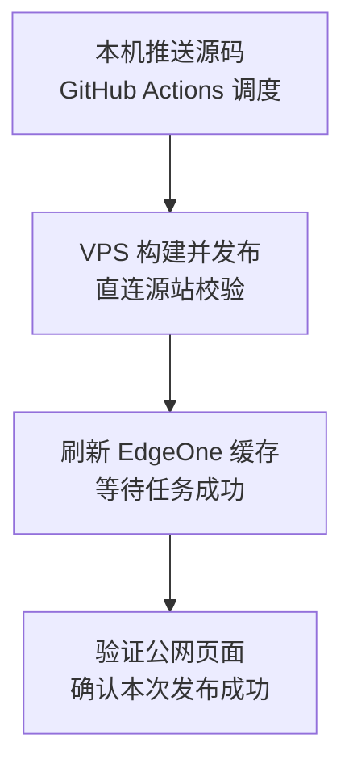

这次折腾的起因很简单：我给博客加了一条友链，推送了代码，GitHub Actions 也是绿色的，但打开网站，就是看不到新内容。

第一反应当然是缓存。刷了几次，还是没有。

最后查下来，问题比缓存更直接：**自动部署确实成功了，只是部署的位置，不是访客实际访问的位置。**

顺着这个问题，我把博客的发布链路重新整理了一遍：从 GitHub Pages 切到 VPS 自托管 runner，再在访问入口接入 EdgeOne，最后补上发布后自动刷新缓存。现在日常操作又回到了一条命令。

本文记录的是本站在 2026 年 10 月完成的这次改造，不是一套不加修改就能复制到任何服务器的安装脚本。

## 一、Actions 成功，为什么网站却没更新？

当时仓库的工作流推送后会构建 Astro，然后通过 `actions/deploy-pages` 发布到 GitHub Pages。

但实际访问链路是这样的：

```text
访问 pasule.github.io
    ↓ GitHub Pages 自定义域名重定向
访问 pasule.com
    ↓ 当时的 DNS 记录
自己的 VPS
    ↓ Nginx
/www/wwwroot/pasule.com/current
```

GitHub Pages 里配置了自定义域名，所以访问 `pasule.github.io` 也会被引导到 `pasule.com`。而当时 `pasule.com` 解析到的是自己的 VPS，Nginx 读的是服务器上的旧 release。

这就有人要问了，为什么使用Github Pages，还要用到VPS呢？


因为这该死的备案以后，域名必须指向服务器所在的ip上的服务，所以我之前dns指向的github pages全部作废😡

不得已，做了一层nginx代理，改了dns配置，这才正常。

换句话说，之前仓库每次都在更新 GitHub Pages，但真正对外提供服务的 VPS 没有同步更新。

这里的教训是：**CI 的绿色，只能证明它配置的步骤执行成功，不能自动证明用户已经访问到这次提交。**

排查这类问题，先确认三件事：

```bash
# 查看是否跳转，以及跳转目标
curl -I https://pasule.github.io/friends/

# 查看正式域名的响应
curl -I https://pasule.com/friends/

# 在源站确认 Nginx 实际使用的 release
readlink /www/wwwroot/pasule.com/current
```

DNS、重定向和 Nginx 根目录要连起来看。只盯着某一次 Actions 日志，很容易查错方向。

## 二、先让 Actions 部署到 VPS，又遇到传输瓶颈

既然真实源站在 VPS，最直接的修正就是让 GitHub Actions 构建后，把 `dist` 上传到 VPS，再切换站点目录。

这条路在功能上没有问题，但在我的网络环境里，GitHub 托管 runner 到 VPS 的传输很慢。一次运行中，构建只用了约 45 秒，部署阶段却触发了自己配置的 10 分钟超时。

注意，这不是 GitHub Actions 统一只能运行 10 分钟，而是当时部署 job 的超时设置。

我也试过本机直接部署：本地构建，再通过 SSH 上传到 VPS，速度明显更好。但如果以后每次发布都依赖本机完成构建、上传，自动化的意义就少了一半。

代理可以改善特定链路，却不保证能解决整包上传的问题。我最终选择的是：**把构建任务移到 VPS 上，让构建产物根本不需要走这段跨境上传链路。**

## 三、自托管 runner：GitHub 调度，VPS 干活

自托管 runner 不等于放弃 GitHub Actions。

GitHub 仍然负责接收 push、触发工作流、调度任务和展示日志，只是执行任务的机器，从 GitHub 提供的机器换成了自己的 VPS。

现在发布流程是：



这里仍然需要从 GitHub 拉取源码，也可能需要下载依赖，并不是从此完全不访问境外网络。但 `dist` 在 VPS 本机生成，发布时走的是本机文件复制，不再从 GitHub 下载整包构建产物，也不再从远端通过 SCP 上传 `dist`。

### 1. runner 使用独立用户

Node.js、pnpm、Git、Python 3 和 rsync 等工具提前安装好，依赖缓存保留在 VPS 上。runner 注册完成后安装为 systemd 服务，服务器重启后会自动启动。

GitHub 注册入口在仓库的 Settings → Actions → Runners → New self-hosted runner。选择实际服务器对应的系统和架构，并给 runner 配置专用标签。本站使用的标签是 `pasule-vps`，因此工作流指定：

```yaml
runs-on: [self-hosted, linux, x64, pasule-vps]
```

注册令牌只在注册时使用，不放进仓库，不贴进文章，也不需要长期保存在业务配置里。
### 2. 代理必须站在执行机器的角度配置

VPS 上已有代理，所以 runner 的联网步骤使用 VPS 自己能访问的代理地址。

有一个容易混淆的地方：**本机的 `127.0.0.1:7897`，对 VPS 来说不是你的电脑。** VPS 里的 `127.0.0.1` 指向 VPS 自己，不能把电脑上的代理地址原样填过去。

另外，交互式 SSH 终端里能用的环境变量，不代表 systemd 启动的 runner 服务也能用。需要为 runner 服务配置代理，并在修改服务环境后重启服务。

这次安装、代理和注册分别封装在仓库的安装脚本与注册脚本中。脚本里的路径、代理、架构和版本是本站配置，复用前要逐项检查，不能直接在另一台生产服务器上盲跑。

### 3. 自托管 runner 不是没有安全代价

runner 能执行工作流中的代码，也能写生产站点的发布目录，因此它本身就是生产权限的一部分。即使不以 root 运行，也不代表它和生产环境完全隔离。

尤其本站是公开仓库，这个取舍需要单独提醒：GitHub 官方明确警告，公开仓库使用自托管 runner 存在较高风险，不应把个人博客的部署方式直接当成通用安全方案。[GitHub runner 安全说明](https://docs.github.com/en/actions/reference/security/secure-use#hardening-for-self-hosted-runners)

多人协作、接收大量外部贡献，或者源站还承载重要业务时，更值得考虑专用构建机器、隔离环境和一次性 runner。**省掉传输时间，不等于可以忽略供应链与生产隔离。**

## 四、发布不再覆盖线上目录，而是切换 release

构建完成后，我没有把新文件直接一股脑覆盖到 Nginx 正在读取的目录，而是保留 release 目录：

```text
/www/wwwroot/pasule.com/
├── current -> releases/某个已验证的版本
├── releases/
│   ├── 上一个版本/
│   └── 本次新版本/
└── shared/
    └── _astro/
```

发布脚本先检查必需的构建文件和 commit 标记，再把 `dist` 复制进一个新 release，同步共享资源，最后原子替换 `current` 软链接。

原子切换解决的是“当前目录指向哪个完整版本”，并不意味着所有缓存和所有用户的页面会在同一瞬间更新。因此还需要后面的验证与缓存刷新。

### 旧页面为什么还要保留旧资源？

访客可能还开着旧 HTML，浏览器和 CDN 也可能暂时保存旧页面。如果发布时把旧版 JavaScript、CSS 和字体全删了，旧 HTML 里引用的资源就可能变成 404。

本站将 `_astro` 中的构建资源同步到共享目录，Nginx 的 `/_astro/` 路由对应这个目录；已有资源不在发布时立即删除。

这不是说 `_astro` 里的任何文件都天然不可变。只有带内容哈希、文件内容变化时 URL 也变化的资源，才适合长期 immutable 缓存。固定 URL 的文件要单独评估。

这个环节还踩过一次权限坑：顶层目录可写，不代表里面原来由 root 创建的字体子目录也可写。runner 第一次同步嵌套资源时就因此失败。修正时应限定在本站需要的发布目录和资源目录，不能用 `chmod -R 777` 解决一切。

### 用 commit 标记确认到底发布了哪个版本

构建后，工作流会生成一个很小的文件：

```bash
printf '{"commit":"%s"}\n' "$GITHUB_SHA" > dist/deployment.json
```

这个文件只包含提交 SHA，不包含密钥。

发布后先在 VPS 上通过本机地址访问源站，但保留正式域名用于 HTTPS 和站点匹配：

```bash
curl --fail --silent --show-error \
  --noproxy '*' \
  --resolve pasule.com:443:127.0.0.1 \
  https://pasule.com/deployment.json
```

这一步要求源站本机 443 能提供 `pasule.com` 对应的有效 HTTPS 站点。不要为图省事加 `-k` 跳过证书校验。

如果这里返回的不是本次 commit，发布脚本会还原上一个 release。先确认源站是好的，再处理 CDN，能把两类故障分开。

## 五、EdgeOne 接在访问入口，不参与 Astro 构建

解决自动发布之后，我又把访问入口切到了 EdgeOne。

这里必须分清几项职责：

| 组件 | 在本站的职责 |
| --- | --- |
| GitHub Actions | 接收提交后调度发布任务 |
| VPS + Nginx | 构建博客，保存并提供真实站点文件 |
| Cloudflare DNS | 继续负责域名解析，记录设置为“仅 DNS” |
| EdgeOne | 作为 CDN，处理访客访问、缓存和回源 |

**本站使用的是 EdgeOne 安全加速，不是 EdgeOne Pages，也不是 Cloudflare Pages 托管。** 域名继续放在 Cloudflare 解析，并不代表网页流量还经过 Cloudflare 的代理网络。

### 免费套餐与中国大陆节点，不能只看“免费”两个字

EdgeOne 有免费套餐，但领取方式、能力、用途限制和配额会调整，不能把“有免费 CDN”理解成任何账号、任何业务都能无限制使用。接入前应以自己的控制台和[免费版套餐使用说明](https://cloud.tencent.com/document/product/1552/118985)为准。

另外，选择中国大陆或包含中国大陆的全球加速区域，有域名备案等接入要求。未备案域名不能因为接入了免费套餐，就自动获得中国大陆节点服务。[EdgeOne 接入说明](https://edgeone.ai/zh/document/54208)

这次本站选择国内外统一走 EdgeOne，没有配置“国内 EdgeOne、国外 Cloudflare”的地域分流。

### 1. 添加站点并验证域名归属

因为不准备迁移 DNS 服务商，我选的是 CNAME 接入。

添加 `pasule.com` 后，按照控制台要求，在当前 DNS 服务商处新增归属验证 TXT 记录，再回 EdgeOne 点击验证。主机记录和记录值以自己的控制台为准，不要照抄别人的验证字符串。

这一步只证明域名归属，并不等于流量已经切过去。

### 2. 配置加速域名和真实源站

本站使用根域名作为加速域名，源站填写 VPS 的真实地址，回源 Host 使用 `pasule.com`。HTTP、HTTPS 端口和回源协议要与源站实际提供的服务一致。

本次接入采用协议跟随，HTTP/HTTPS 对应 80/443；其中 HTTPS 回源使用源站的 443。若源站只提供 HTTPS，也可以按实际情况固定 HTTPS 回源。

不要把已经指向 EdgeOne 的同一个加速域名再填成它自己的源站，否则可能形成回源循环。回源 Host 也不能随便填：一台 Nginx 上有多个站点时，它会影响请求落到哪个虚拟主机。

### 3. 把 DNS 指向分配的 CNAME

控制台为本站分配的 CNAME 是 `pasule.com.eo.dnse1.com`。实际操作时，读者应使用自己站点获得的目标，不是所有站点都指向这一条。

Cloudflare 中最终配置为：

| 类型 | 名称 | 目标 | 代理状态 |
| --- | --- | --- | --- |
| CNAME | `@` | `pasule.com.eo.dnse1.com` | 仅 DNS，也就是灰云 |

我第一次直接新增时，Cloudflare 提示已经存在同名 A、AAAA 或 CNAME。原因是根域名之前已经有源站 A 记录。确认旧记录用途并保留回退信息后，才能将其替换为新的 CNAME，不能让同名冲突记录同时存在。

根域名 CNAME 还有一个细节：Cloudflare 默认会对根域名进行 CNAME flattening，所以外部查询可能直接得到最终 A/AAAA，而不是看到一条 CNAME。这不一定是配置失败。[Cloudflare 官方说明](https://developers.cloudflare.com/dns/cname-flattening/set-up-cname-flattening/)

`www` 是另一个主机名。如果要让它也稳定提供服务，需要检查加速域名、证书、DNS 或跳转配置，不能因为根域名已接入，就认为 `www` 自动全部完成。

### 4. HTTPS 要检查两段

接入过程中，我还遇到过边缘节点返回默认 `*.cdn.myqcloud.com` 证书的情况。源站证书正常，并不代表 CDN 边缘已经部署了自己域名的证书。

要分别确认：

- 访客 → EdgeOne：边缘证书覆盖 `pasule.com`。
- EdgeOne → VPS：回源协议、端口、Host，以及 HTTPS 回源时所需的源站证书配置正确。

不能只看控制台里的“配置完成”。还要用真实 HTTPS 请求验证，不能关闭证书校验来掩盖证书问题。

## 六、EdgeOne接入以后的CICD和访问流程

### 自动发布


### 访客访问


在图中的网页请求发生前，浏览器先通过 DNS 找到 EdgeOne。DNS 查询和网页请求是两件事：Cloudflare DNS 告诉浏览器去哪里，真正的网页请求走访客与 EdgeOne 之间的连接。缓存需要回源时，EdgeOne 再访问 VPS。

这也解释了为什么 self-hosted runner 和 EdgeOne 不重复：前者解决“如何发布”，后者解决“如何交付给访客”。
## 七、部署成功后，还要自动刷新 EdgeOne 缓存

接入 CDN 后，如果源站文件已经更新，但节点上的旧 HTML 还没过期，访客仍然可能看到旧内容。

所以我把刷新缓存变成发布流程的一部分，而不是每次上线后再手动去控制台点一下。

完整顺序是：

```text
构建 → 写入 commit 标记 → 切换 release
    → 直连源站验证
    → 提交 EdgeOne 刷新任务
    → 等待任务成功
    → 通过 EdgeOne 验证公网内容
```

### 1. 使用专用子用户，不用主账号密钥

腾讯云 CAM 中创建专用子用户 `edgeone-deploy`，访问方式选择编程访问。权限列表里选的是“策略”，不是直接搜索某个 API 就一定有一条现成策略。

因此需要新建自定义策略，在边缘安全加速平台 EO（`teo`）下，只允许两个操作：

```text
teo:CreatePurgeTask       创建刷新任务
teo:DescribePurgeTasks   查询刷新任务状态
```

资源选择“特定资源”，添加本站实际的 `zone-…` 站点，而不是勾选全部资源；创建策略后，再关联到子用户。这两个操作的授权粒度可以查[腾讯云 CAM 权限表](https://cloud.tencent.com/document/product/598/99327)。

来源 IP 可以进一步限制，但要先确认实际 API 出口。runner 使用代理时，出口不一定是 VPS 的公网 IP；填错会造成接口鉴权失败。这个条件要基于真实出口配置，不能照抄示例地址。

### 2. 密钥只放 GitHub Environment Secrets

仓库 Settings → Environments → `production` → Environment secrets 中添加：

| Secret 名称 | 内容 |
| --- | --- |
| `TENCENTCLOUD_SECRET_ID` | 专用子用户的 SecretId |
| `TENCENTCLOUD_SECRET_KEY` | 专用子用户的 SecretKey |
| `EDGEONE_ZONE_ID` | `pasule.com` 对应的 `zone-…` 站点 ID |

站点 ID 不是域名，也不是套餐 ID。工作流需要声明 `environment: production`，才能在这个环境的上下文中使用对应 secrets。

密钥不要提交到仓库、不要放进文章截图，也不要输出到 Actions 日志。环境 secrets 同样不能替代 runner 的执行隔离：能执行受信任工作流的代码，仍属于敏感的权限边界。

### 3. 提交 Hostname 刷新，并等待它真正完成

本站调用的是 `CreatePurgeTask`，API 版本为 `2022-09-01`。请求参数的核心部分如下，站点 ID 是示意值：

```json
{
  "ZoneId": "zone-example",
  "Type": "purge_host",
  "Method": "invalidate",
  "Targets": ["pasule.com"]
}
```

这里不是清除站点下所有主机名，而是刷新 `pasule.com` 这个 Hostname。`invalidate` 会将资源标记过期，后续请求可触发回源校验；没有变化的内容可以通过源站的 304 响应继续复用，不等于立刻把全部资源重新下载一遍。[CreatePurgeTask 文档](https://cloud.tencent.com/document/api/1552/80703)

接口返回 JobId 只能说明任务已提交。脚本还要通过 `DescribePurgeTasks` 查询该 JobId，等待任务成功；遇到失败、超时，或者一直查不到结果，都不能当作刷新完成。[DescribePurgeTasks 文档](https://cloud.tencent.com/document/api/1552/80699)

这一部分放在 `scripts/edgeone-purge.py` 中，使用 Python 标准库完成请求签名和调用，没有额外安装 SDK。脚本只在配置检查和刷新步骤读取 secrets，不把它们注入整套构建环境。

工作流里的刷新步骤是：

```yaml
- name: Refresh EdgeOne cache and wait for completion
  timeout-minutes: 7
  env:
    TENCENTCLOUD_SECRET_ID: ${{ secrets.TENCENTCLOUD_SECRET_ID }}
    TENCENTCLOUD_SECRET_KEY: ${{ secrets.TENCENTCLOUD_SECRET_KEY }}
    EDGEONE_ZONE_ID: ${{ secrets.EDGEONE_ZONE_ID }}
  run: python3 scripts/edgeone-purge.py
```

脚本最多等待刷新任务 5 分钟，工作流步骤额外留出请求和执行时间。缺少 secrets 会在正式发布前的配置检查中失败；但“配置存在”不代表已经通过腾讯云鉴权，实际权限仍要通过 API 调用验证。

### 4. 刷新完成，还要验证公网看到的内容

最后一步不是再直连源站，而是访问正常的公网地址：

```text
https://pasule.com/deployment.json
https://pasule.com/
https://pasule.com/friends/
```

这些请求不加随机查询参数来绕过缓存。工作流会确认 commit 标记正确，并将首页、友链页的响应正文与本次 `dist` 中的文件进行比较。

本站没有启用会改写 HTML 的边缘转换，所以可以进行字节级比较。若启用了 HTML 压缩、内容注入或其他响应改写，就要调整验证方式，不能机械照搬 `cmp`。

这能验证所访问的公网路径已经更新，但不是对全球所有节点逐个验收。除此之外，CDN 刷新也无法清掉访客浏览器已经保存的本地缓存；浏览器缓存策略需要单独设计。

## 八、失败之后，应该回滚还是保留新版本？

这次我把失败分成了两类，而不是只要 Actions 红了就统一回滚：

| 失败位置 | 当前处理方式 |
| --- | --- |
| 构建或发布前检查 | 不切换线上版本 |
| 切换后，直连源站验证失败 | 还原上一个 release，保留新 release 供排查 |
| 源站通过，但 EdgeOne 刷新或公网校验失败 | Actions 报错，保留已验证的新源站，排查缓存或公网链路 |

原因很实际：新源站已经验证正确，CDN 刷新暂时失败，不等于源站代码有问题。贸然回滚会把已经正确的新版本撤掉，也可能让缓存状态更难判断。

另外，旧 release 和共享资源不会自动无限制清理。现在先保留，后面还需要按磁盘容量制定清理策略，删除前确认没有仍被旧页面引用的资源。

## 九、这一路踩过的其他小坑

### SSH 私钥、公钥和 known_hosts 是三回事

早期远程上传需要 SSH：服务器保存对应的授权公钥，CI 保存用于身份认证的私钥，`known_hosts` 则用来核对服务器身份。

`VPS_SSH_KEY` 里需要的是完整私钥，不是 `.pub` 公钥文件。服务器主机公钥也不是登录私钥，不要混淆。

遇到 `Host key verification failed` 时，应该通过可信渠道核对主机指纹并修正 `known_hosts`，而不是关闭 StrictHostKeyChecking。`ssh-keyscan` 获取到的内容本身并不构成可信身份验证。

改成在 VPS 本机执行发布后，日常 CI 不再依赖从 GitHub 通过 SSH 上传站点；SSH 直传只保留为备用方式。

### 本地备用部署不等于正常自动部署

现在默认 push 脚本只负责提交和推送，然后等待 GitHub 调度 VPS runner。

本地直传保留给应急场景，但当前备用路径不会自动调用 EdgeOne 刷新脚本，而且推送本身仍可能触发 CI。不要把两条发布路径同时无计划运行，也不要以为本地发布成功就等于 CDN 已刷新。


对应实现可以从仓库查看，以下链接固定到这次改造完成时的提交：

- [自动部署工作流](https://github.com/pasule/pasule.github.io/blob/4dcca1f961765632f26d09c9cab4e34d4e5fd531/.github/workflows/deploy.yml)
- [VPS 本机发布与源站验证](https://github.com/pasule/pasule.github.io/blob/4dcca1f961765632f26d09c9cab4e34d4e5fd531/scripts/deploy-on-vps.sh)
- [EdgeOne 刷新与等待脚本](https://github.com/pasule/pasule.github.io/blob/4dcca1f961765632f26d09c9cab4e34d4e5fd531/scripts/edgeone-purge.py)
- [刷新逻辑离线测试](https://github.com/pasule/pasule.github.io/blob/4dcca1f961765632f26d09c9cab4e34d4e5fd531/scripts/edgeone_purge_test.py)

